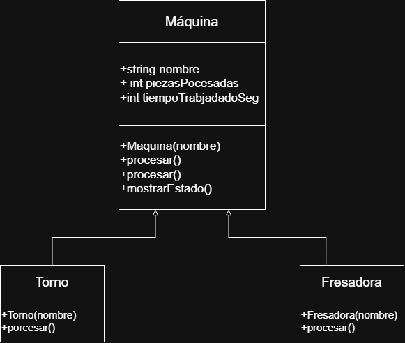
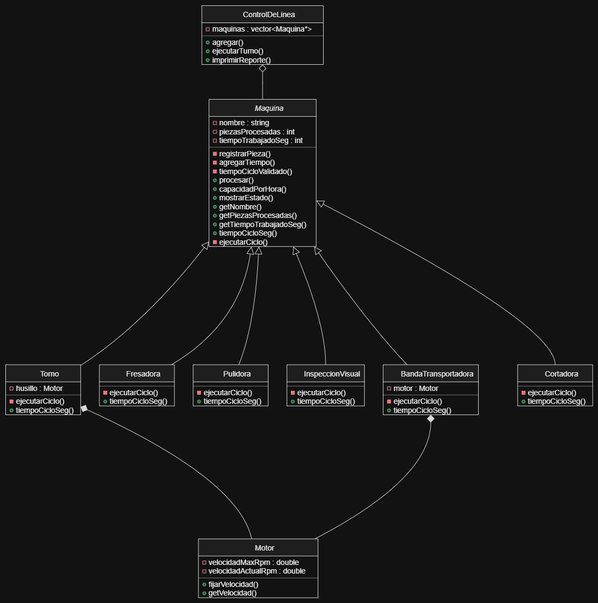

# Práctica Unidad IV: La evolución de una máquina

Programación Orientada a Objetos · Ingeniería Mecatrónica · Tercer semestre

Llena cada espacio conforme avances en las fases de [PRACTICA.md](PRACTICA.md).

## Fase 1. Entender el problema

**1.1 El problema con mis propias palabras**

La planta necesita un sistema para controlar las diferentes máquinas de la línea de producción, hay que hacer una jerarquía de clases para reutilizar códigos y evitar errores

**1.2 Reglas que siempre deben cumplirse en una máquina** (escribe al menos tres)

1. El nombre de la máquina no puede estar vació
2. El número de piezas producidad, ni el tiempo trabajado puede ser 0
3. El tiempo del ciclo de trabajo siempre tiene que ser mayor a 0
4. Cada ciclo debe registrar solamente una pieza producida

**1.3 ¿Quién más usa la clase `Maquina`? ¿Qué podría salir mal si otro equipo crea una máquina nueva sin conocer tus reglas?**

La clase maquina puede ser utilizada por otro desarrollador para crear más máquinas para la línea de producción, si no conocen sus regalas pueden llegar a crear máquinas con estados y/o valores invalidos.

## Fase 2. Diseñar la solución

**2.1 Diagrama inicial (Etapa 0)**

**2.2 Diagrama final (Etapa 9)**

**2.3 ¿Qué cambió entre los dos diagramas?**

| Elemento | Etapa 0 | Etapa 9 | Etapa que lo cambió |
| --- | --- | --- | --- |
| Visibilidad de los atributos de `Maquina` | public | private | etapa 1 |
| `procesar()` | procesos normal | No virtual | 7 |
| `tiempoCicloSeg()` | No existía | virtual puro | 5 |
| Destructor de `Maquina` | No existía | virtual = maquina | 4 |
| ¿Se pueden crear objetos `Maquina`? | Si | No | 5 |
| Relación `ControlDeLinea` - `Maquina` | No existía | Agregación | 3 |
| Relación `Torno` - `Motor` | No existe | Composición | 4 |
| Relación `BandaTransportadora` - `Motor` | Era una herencia | Composición | 8 |
## Fase 3. Implementar

**3.0 Etapa 0. Una máquina sin reglas**

a) ¿Qué imprime `ejecutarTurno()` para el torno y la fresadora? ¿Por qué no imprime "torneando" ni "fresando"?
Porque ejecutarTurno recibe un objeto de tipo máquina y procesar no es virtual. El compilador llama un enlace estático llamado Maquina::procesar().

b) ¿Por qué el torno acumula 65 s y no 135 s?
Porque a la primera llamada directa usa Torno::procesar y suma 45 segundos, mientras que las otras veces usan Maquina::procesar() y suman 10 segundos cada una

**3.1 Etapa 1. Invariantes y constructores explicit**

a) ¿Qué regla de la sección 1.2 rompió `torno.piezasProcesadas = -5;`?

La que dice que las piezas procesadas no pueden ser negativas

b) ¿De dónde salió la máquina "Fantasma"? ¿Qué hizo el compilador sin que se lo pidieras?

De que el compilador convirtío el string a un objeto maquina 

c) ¿Qué tuviste que cambiar en `Torno` y `Fresadora` y por qué?

Cambie el acceso directo por un getNombre(), registrarPiezas(), agregarTiempo() porque los atributos se volvieron pribados 

**3.2 Etapa 2. Virtual y override**

a) La fresadora acumula 180 s, pero reporta 360 pzas/h. ¿Por qué un cálculo usó 60 s y el otro 10 s?

tiempoTrabajadoSeg usó el método de la fresadora, pero capacidadPorHora() llamó a la versión heredada de Maquina debido a que faltaba el const y realmente no estaba sobrescribiendo el método.

b) ¿Tu compilador mostró alguna advertencia antes de usar `override`? ¿Qué mensaje dio después de agregar `override`?

El compilador indicó que el método estaba ocultando una función virtual de la clase base. Al usar override apareció un error indicando que no sobrescribía ningún método.

**3.3 Etapa 3. La línea de producción**

a) ¿Por qué la línea procesó todo como "generico" si `procesar()` ya es virtual?

Porque se produjo slicing al almacenar objetos derivados dentro de un vector.   

b) ¿Por qué el torno y la fresadora originales quedaron con 0 piezas?

Porque ControlDeLinea trabajaba con copias de los objetos originales.

c) La relación entre `ControlDeLinea` y `Maquina`, ¿es composición o agregación? ¿Por qué?

Agregación, porque las máquinas existen independientemente de la línea y ésta no las destruye.

**3.4 Etapa 4. Destructores**

| Momento | Mensajes de destrucción que aparecieron |
| --- | --- |
| `delete temporal;` sin destructor virtual | Destruyendo Maquina |
| `delete temporal;` con destructor virtual | Destruyendo Torno → Destruyendo Motor → Destruyendo Maquina |
| Al terminar `main` (torno y fresadora) | Destruyendo Motor → Destruyendo Maquina (para cada objeto según corresponda) |

a) ¿Qué advertencia mostró el compilador? ¿Por qué decimos que ya te estaba avisando del problema?

"deleting object of polymorphic class type that has non-virtual destructor"

Indicaba que destruir un objeto derivado mediante un puntero a la base podía causar comportamiento indefinido.

b) ¿Por qué el torno de `main` sí se destruyó completo aunque el destructor no fuera virtual? ¿A qué máquina corresponde el primer "Destruyendo Maquina" después de "Fin de main"?

Porque era un objeto local de tipo Torno y el compilador conocía su tipo real durante la destrucción.

**3.5 Etapa 5. La clase abstracta**

a) Copia los mensajes de error y explica con tus palabras qué dice cada uno.

[Inserta aquí tu respuesta]

b) ¿Por qué es mejor este error de compilación que el comportamiento "generico" de antes?

Porque detecta el problema antes de ejecutar el programa y evita reportes incorrectos.

**3.6 Etapa 6. El contrato que el compilador no ve**

a) ¿Qué partes del contrato violó `InspeccionVisual`?

No registró piezas.
No agregó tiempo.
Regresó un tiempo de ciclo igual a 0.

b) ¿Por qué el compilador no lo detectó?

Porque las firmas de los métodos eran correctas; el compilador sólo verifica la forma del contrato, no su comportamiento.

c) ¿Qué pasaría si el próximo equipo tampoco lee el comentario del contrato?

Se repetirían los mismos errores y los reportes volverían a contener información incorrecta.

**3.7 Etapa 7. La base hace cumplir el contrato**

a) ¿Cómo puede una clase derivada sobrescribir un método que es privado en la base?

Porque private controla el acceso y virtual controla el polimorfismo. Son mecanismos independientes.

b) ¿Qué ocurre ahora con una máquina cuyo tiempo de ciclo es 0? Compáralo con la Etapa 6.

Ahora se lanza una excepción y el error se detecta inmediatamente.

c) ¿Por qué la línea ignoró el "atajo" del torno, pero la llamada directa no? ¿Cómo corregiste el diseño?

Porque la línea usa Maquina* y llama al procesar() de la clase base.
Eliminando el atajo y manteniendo el patrón NVI.

**3.8 Etapa 8. Herencia mal usada**

a) Da al menos dos razones por las que `BandaTransportadora : public Motor` es un error de diseño.

Una banda transportadora no es un motor.
Se expone fijarVelocidad() al resto del programa cuando debería ser interno.

b) La relación entre `BandaTransportadora` y `Motor`, ¿es composición o agregación? ¿Por qué?

Composición, porque la banda tiene un motor propio para funcionar.

**3.9 Etapa 9. La librería y la prueba final**

a) Después de agregar la `Cortadora`, ¿qué archivos mostró `git status`? ¿Cuántos archivos de la librería tuviste que modificar?

Ninguno.
Sólo se agregaron:

Cortadora.h
Cortadora.cpp
main.cpp

b) ¿Qué pasó al escribir `-lplanta` antes de `src/main.cpp`? ¿Por qué?

Aparecieron errores "undefined reference" porque el enlazador resuelve dependencias de izquierda a derecha.
**3.10 Bitácora de dudas**

| # | Etapa | Duda | Cómo la resolví | Fuente |
| --- | --- | --- | --- | --- |
| 1 | 2 | ¿Por qué tiempoCicloSeg() de Fresadora no sobrescribía el método de la base? | Revisé la firma del método y encontré que faltaba const; al agregar override el compilador mostró el error. | Documentación de C++ y guía de la práctica |
| 2 | 3 | ¿Por qué la línea procesaba todo como genérico aunque procesar() era virtual? | Analicé el uso de vector<Maquina> y comprendí el problema de slicing. Se corrigió usando vector<Maquina*>. | Guía de la práctica |
| 3 | 4 | ¿Por qué se mostraba una advertencia al hacer delete mediante un puntero de tipo Maquina*? | Investigué el uso de destructores virtuales y entendí que la base debía tener un destructor virtual para destruir correctamente las derivadas. | Guía de la práctica y documentación de C++ |

## Fase 4. Probar y mejorar

**4.1 Tabla de pruebas**

| # | Caso | Resultado esperado | Resultado obtenido | ¿Pasa? |
| --- | --- | --- | --- | --- |
| 1 | Máquina con nombre vacío | Excepción con mensaje claro | Se lanzó invalid_argument indicando que el nombre no puede estar vacío | | si |
| 2 | Reporte de una línea vacía | "La linea no tiene maquinas" | Se mostró el mensaje esperado | si |
| 3 | `agregar(nullptr)` | Devuelve `false` | El método devolvió false y no agregó la máquina | si |
| 4 | Reporte antes de ejecutar el turno | 0 piezas, 0 s y capacidad calculada | Se mostraron 0 piezas, 0 s y la capacidad según cada máquina | si |
| 5 | Turno de 0 ciclos | Nada cambia | Los valores permanecieron sin cambios | si |
| 6 | Torno con 3 ciclos | 3 piezas, 135 s, 80 pzas/h | Se obtuvieron exactamente esos valores | si |
| 7 | Máquina con `tiempoCicloSeg()` igual a 0 | Excepción con mensaje claro | Se lanzó logic_error indicando tiempo de ciclo inválido | si |
| 8 | Máquina con `tiempoCicloSeg()` negativo | Excepción con mensaje claro | Se lanzó logic_error indicando tiempo de ciclo inválido | si |
| 9 | La misma máquina agregada dos veces | No debería duplicarse en la línea | La máquina apareció dos veces en el reporte y procesó el doble de ciclos | no |

**4.2 Bitácora de mejoras**

| # | Falla o mejora detectada | Qué cambié | Por qué |
| --- | --- | --- | --- |
| 1 | Una misma máquina podía agregarse varias veces | Agregué validación para evitar duplicados en ControlDeLinea | Evita reportes incorrectos y procesamiento repetido |
| 2 | Mensajes de error poco descriptivos | Mejoré los textos de las excepciones | Facilita identificar rápidamente la causa del problema |

Retos opcionales que intenté: Rechazar máquinas duplicadas en la línea de producción. Cabe resaltar el intentar

## Fase 5. Publicar en GitHub

**5.1 Enlace a mi fork**

[Inserta aquí el enlace a tu fork]

## Cierre y reflexión

**6.1 Errores que ya no pueden ocurrir**

| Error | Etapa en que apareció | Restricción que lo impide ahora | ¿Quién lo detecta: el compilador o el programa? |
| --- | --- | --- | --- |
| Contadores con valores inválidos |1 | Atributos privados y métodos de validación | Compilador |
| Máquina "fantasma" creada a escondidas | 1 | Constructor explicit | Compilador |
| Método que no sobrescribe por un `const` | 2 | Uso de override | Compilador |
| Máquinas copiadas y "rebanadas" | 3 | Uso de punteros a Maquina en lugar de objetos por valor | Diseño / Compilador |
| Destrucción incompleta | 4 | Destructor virtual | Compilador |
| Máquina sin `procesar()` propio | 5 | Clase abstracta y métodos virtuales puros | Compilador |
| Tiempo de ciclo inválido | 6 y7 | tiempoCicloValidado() | Programa |
| Derivada que no registra sus piezas | 7 | Patrón NVI con procesar() controlado por la base | Programa |

**6.2 ¿Cuál de los errores fue el más peligroso: el de compilación, la advertencia o el que compilaba sin problemas? ¿Por qué?**

El error más peligroso fue el que compilaba sin problemas. Los errores de compilación y las advertencias llaman la atención del programador, pero un error que compila correctamente puede producir resultados incorrectos sin que nadie lo note. Un ejemplo fue la estación de inspección que generaba reportes con capacidad infinita y cero piezas procesadas.

**6.3 ¿Qué aprendiste en esta práctica?**

Aprendí la importancia de diseñar correctamente una jerarquía de clases utilizando encapsulamiento, herencia y polimorfismo. También comprendí cómo los modificadores private, protected, virtual, override, los destructores virtuales y las clases abstractas ayudan a prevenir errores. Además, aprendí a distinguir entre herencia, composición y agregación, y a diseñar clases que sean fáciles de extender sin modificar el código existente.

**6.4 ¿Qué cambiarías de tu proceso la próxima vez?**

La próxima vez dedicaría más tiempo al diseño UML antes de programar. También realizaría pruebas más frecuentes después de cada cambio y prestaría mayor atención a las advertencias del compilador, ya que pueden anticipar errores importantes antes de que lleguen a la ejecución.